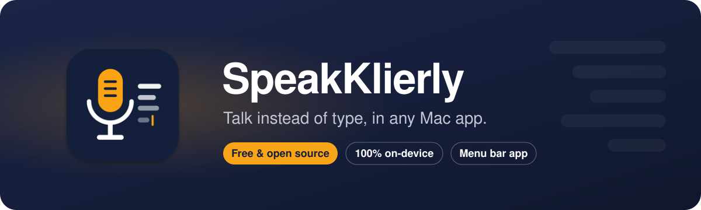
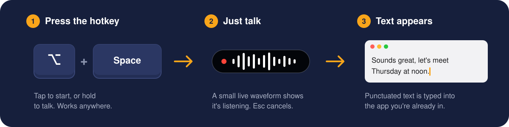
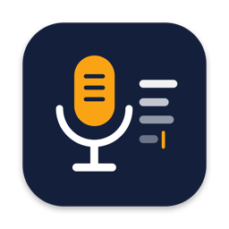

<p align="center">
  
</p>

<p align="center">
  
  
  
  
  <a href="https://buymeacoffee.com/iceshoot48"></a>
</p>

**SpeakKlierly** is a free, open-source dictation app for the Mac. Press a hotkey, say what you want to write, and clean, punctuated text appears wherever your cursor is: email, Slack, Notes, a code editor, a chat with an AI assistant, anything.

It lives quietly in your menu bar and does all of its speech recognition **on your Mac**. Your voice never leaves your computer, there's no account to create, and there's no subscription.

## Why not just use Siri, or the mic button in a search box?

Those are built for **short requests**. SpeakKlierly is built for **writing**.

- **A mic button only works where someone put one.** It lives inside a single search box or website, and many web mic buttons send your audio to a server to be transcribed. SpeakKlierly works in *every* app from one shortcut: your email, Slack, Notes, a terminal, a code editor or an AI chat box. If you can paste there, you can dictate there.
- **Siri is an assistant, not a typist.** Ask Siri something and it tries to *do* something: search the web, set a timer, open an app. SpeakKlierly never acts on your words. It writes down exactly what you said, right where your cursor is.
- **Made for long thoughts, not three-word queries.** It uses Apple's long-form dictation model with automatic punctuation, so you can talk through a whole email or a detailed prompt in one go and get clean sentences back.
- **You stay in control.** Tap to start and tap to stop, or hold the key and let go. Your text arrives all at once when you finish, instead of flickering half-typed into the page. Changed your mind? Press <kbd>Esc</kbd> and nothing is typed.
- **Private, and you can check it.** Everything is transcribed on your Mac. There are no servers, accounts or analytics, and the code is open, so you don't have to take our word for it.

| | Mic button in a search box | Siri | **SpeakKlierly** |
|---|:---:|:---:|:---:|
| Works in any app | ❌ Only that box | ❌ | ✅ |
| Writes exactly what you say | ✅ | ❌ Tries to act on it | ✅ |
| Built for long writing, with punctuation | ❌ Short queries | ❌ | ✅ |
| Your own global shortcut, push-to-talk | ❌ | ❌ | ✅ |
| Cancel before anything is typed | ❌ | ❌ | ✅ |
| On-device and open source | Varies | ❌ Not open source | ✅ |

---

## How it works

<p align="center">
  
</p>

1. **Press <kbd>⌥ Option</kbd> + <kbd>Space</kbd>** in any app.
2. **Talk.** A small pill with a live waveform appears at the bottom of your screen, so you always know when you're being heard.
3. **Press the hotkey again.** Your words are transcribed and typed right where your cursor is.

Prefer push-to-talk? **Hold** the hotkey while you speak and let go when you're done. Changed your mind? Press <kbd>Esc</kbd> to cancel and nothing is typed.

## Why you'll like it

| | |
|---|---|
| 🎙️ **Works in every app** | If you can type there, you can dictate there. No plugins or per-app setup. |
| 🔒 **Private by design** | Uses Apple's on-device speech recognition. No audio is uploaded, and there are no servers, accounts or tracking. |
| ⚡ **Fast to start** | One shortcut from anywhere. The speech model is downloaded in advance, so dictation starts right away. |
| ✍️ **Clean, punctuated text** | Built for long-form writing like emails, messages, notes and prompts, with automatic punctuation. |
| 📋 **Respects your clipboard** | Text is pasted in for you, then your previous clipboard contents are put back. |
| 🎛️ **Yours to tweak** | Pick any shortcut, turn sounds and the on-screen indicator on or off, and launch at login. |
| 💸 **Free and open source** | MIT licensed. Read the code, change it, share it. |

## Features

- **Global hotkey** (<kbd>⌥ Space</kbd> by default, fully customizable, including F-keys)
- **Tap to toggle or hold to talk**, whichever feels natural
- **Floating recording indicator** with a live audio waveform that never steals focus
- **Start and stop sounds** so you can dictate without looking
- **Copy Last Transcript** from the menu bar, in case you need it again
- **Launch at login**, so it's always ready
- **Graceful fallbacks:** if typing permission isn't granted yet, your text is still copied to the clipboard and nothing is lost
- **Menu bar only:** no Dock icon and no windows in your way

## Requirements

- macOS 27 or later
- A microphone (built-in is fine)
- A system language supported by Apple's on-device dictation

## Install

### Download

1. Grab the latest `SpeakKlierly-<version>.zip` from the [latest release](https://github.com/IceShoot48/SpeakKlierly/releases/latest).
2. Unzip it and drag **SpeakKlierly.app** into your **Applications** folder. Don't open it straight from Downloads, or macOS won't save its permissions.
3. Open it. SpeakKlierly isn't notarized by Apple, so the first time macOS will say it "could not verify" the app and only offer **Done**. That's expected. To allow it:
   - Open **System Settings → Privacy & Security**.
   - Scroll down to the message about SpeakKlierly and click **Open Anyway**.
   - Confirm with your password or Touch ID.

   You only need to do this once. After that, SpeakKlierly opens normally.

> After installing a newer version, macOS may ask for the Microphone and Accessibility permissions again.

### Build from source

You'll need Xcode (or the Xcode Command Line Tools) installed.

```bash
git clone https://github.com/IceShoot48/SpeakKlierly.git
cd SpeakKlierly
./build.sh install
```

This builds `SpeakKlierly.app`, copies it to `/Applications` and launches it. To build without installing, run `./build.sh` and find the app in `build/`.

### First launch

The first time it runs, SpeakKlierly opens a short **Finish setting up** screen with two steps. Click **Allow** on each one:

| Step | Permission | Why it's needed |
|---|---|---|
| 1 | **Microphone** | To hear you while you're dictating, and only then. |
| 2 | **Accessibility** | To paste the finished text into the app you're using. |

For Accessibility, macOS opens System Settings. Switch **SpeakKlierly** on there, and the setup screen ticks it off by itself. If SpeakKlierly isn't in the list, click **+** and choose it from Applications.

**Is it safe to allow these?** Yes. SpeakKlierly only listens while your shortcut is active, turns speech into text on your Mac, and only uses Accessibility to paste that text. Nothing is uploaded, and the code is right here for anyone to check.

The setup screen comes back on each launch until both are allowed. You can also check them any time under **Settings → Permissions**.

> **Tip:** If you have an Apple Development certificate, `build.sh` signs the app with it automatically, so macOS remembers your permissions across rebuilds.

## Settings

Click the SpeakKlierly icon in the menu bar and choose **Settings…** (or press <kbd>⌘ ,</kbd>).

- **Dictation hotkey:** click it, then press the new shortcut you want
- **Show recording indicator** at the bottom of the screen
- **Play start and stop sounds**
- **Restore clipboard** after inserting text
- **Start automatically when you log in**

## Privacy

SpeakKlierly listens to your microphone **only** while dictation is active. Speech recognition runs entirely on your Mac using Apple's built-in speech models. The app makes no network requests of its own and collects no data. Your settings are stored locally in macOS preferences.

## Project layout

```
Sources/SpeakKlierly/
├── SpeakKlierlyApp.swift      # Menu bar app and menu
├── DictationController.swift  # Ties the hotkey, transcription, indicator and typing together
├── Transcriber.swift          # On-device speech recognition (SpeechAnalyzer)
├── TextInserter.swift         # Pastes text into the frontmost app, restores the clipboard
├── HotKey.swift               # System-wide hotkey
├── RecordingOverlay.swift     # Floating waveform pill
├── SettingsView.swift         # Settings window
├── AppSettings.swift          # Saved preferences
└── MenuBarIcon.swift          # Menu bar glyph
Resources/                     # Info.plist and app icon
build.sh                       # Builds, signs and (optionally) installs the app
```

## Support SpeakKlierly

SpeakKlierly is free and always will be, with no ads, no subscription and no paid tier. If it saves you time and you'd like to say thanks, you can buy me a coffee. It helps me keep improving the app.

<p>
  <a href="https://buymeacoffee.com/iceshoot48"></a>
</p>

Starring the repo and telling a friend helps too.

## Contributing

Bug reports, ideas and pull requests are welcome. Open an issue to talk about a change, or just send a PR.

## License

SpeakKlierly is free and open source under the [MIT License](LICENSE).

<p align="center">
  <br>
  <sub>Made for people who think faster than they type.</sub>
</p>
